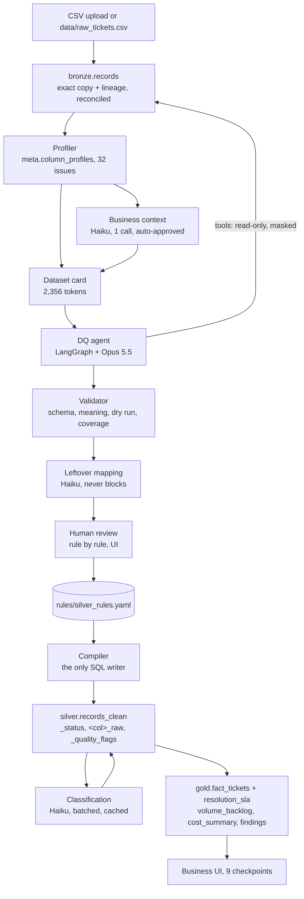
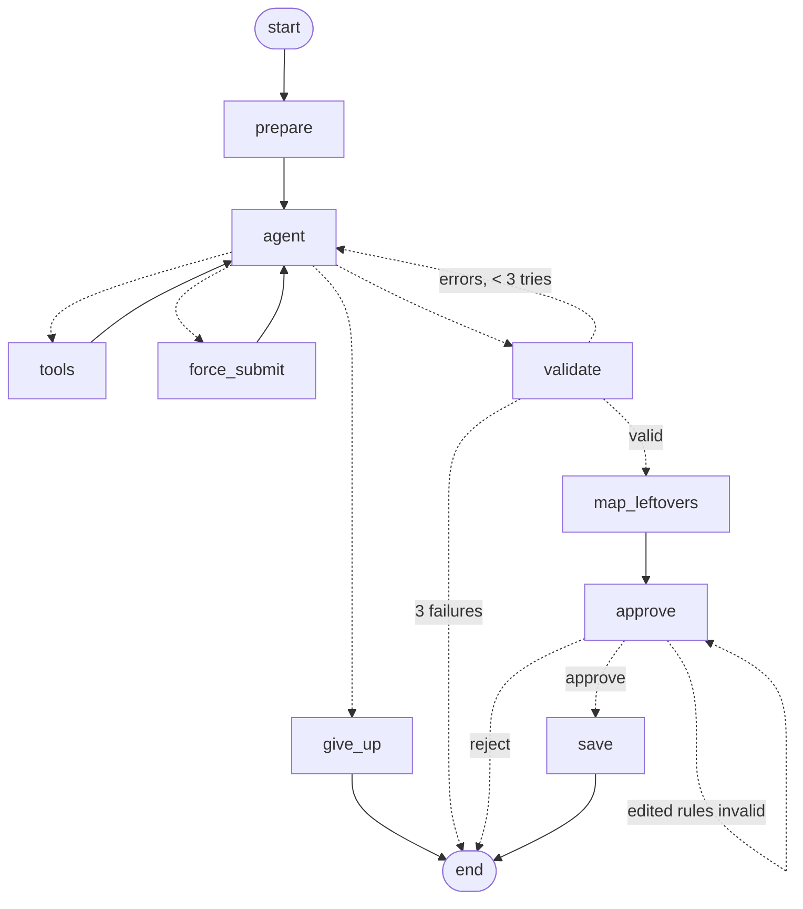

# Data Medallion

A bronze → silver → gold pipeline for messy CSVs on PostgreSQL, where AI agents propose and people
approve, and plain code executes. Built and measured on `data/raw_tickets.csv` (10,280 facilities
tickets × 13 columns). One command rebuilds everything from a fresh clone with no API key.

| | raw_tickets.csv |
| --- | --- |
| Bronze | 10,280 / 10,280 records stored as-is, 0 lost, reconciled |
| Health check (profiler, no LLM) | 32 issues: 5 high, 25 medium, 2 low |
| DQ agent (Opus 5.5) | 14 rules, 15 turns, 22 tool calls, $0.72, 137 s, 0 failed validations |
| Human review | rule by rule in the UI; 3 changes (priority spellings, epoch dates, `it_network`) |
| Silver | 8,386 clean + 1,872 with a warning = 10,258 usable; 22 rejected |
| Classification (Haiku 5.5) | 952 categories recovered from text, 25 unsure; $0.021; rerun 100% cache |
| Gold | fact + 3 marts + 5 data-quality findings; 5/5 reconciliation checks |
| Headline finding | `resolved_at` is unrelated to `created_at` (correlation 0.01): time metrics are not meaningful for this file |
| Tests | 205 |
| Total LLM spend on this file, whole project | $1.67 |

## Contents

[Architecture](#architecture) · [How to run](#how-to-run) · [Bronze](#bronze) · [Silver](#silver) ·
[Gold](#gold) · [Findings](#findings-on-raw_ticketscsv) · [Agents (assessment)](#agents-assessment) ·
[UI](#ui) · [Scaling to 100x](#scaling-to-100x) · [Tradeoffs](#tradeoffs) ·
[Not built](#what-i-chose-not-to-build) · [Open items](#open-items) · [Time spent](#time-spent) ·
[Decisions](docs/decisions.md) · [Metric contracts](docs/metrics.md)

## Overview

Principle: **agents propose, code executes, people approve.** No LLM touches data or writes SQL.

- The profiler measures every column in code (counts, formats, placeholders, date order) and flags
  issues with evidence.
- The DQ agent reads a compact, masked summary of that profile, investigates with read-only tools, and
  submits cleaning rules as strict JSON. A validator checks them in four layers, including a dry run
  on 2,000 real rows and coverage of every high and medium issue.
- A person reviews each rule in the UI. Approved rules (`rules/silver_rules.yaml`) are compiled to SQL
  by one compiler and built into silver with value-level lineage.
- A cheap model recovers categories from free text where rules could not, cached and closed-list.
- Gold is hand-written SQL with written metric contracts and a table of data-quality findings, so a
  number never appears without how much data it covers and what limits it.

## Architecture



DQ agent graph (`python -m pipeline.cli dq-graph`, also in [docs/dq_agent_graph.md](docs/dq_agent_graph.md)):



| Postgres schema | Holds |
| --- | --- |
| `meta` | runs and load funnels, profiles, contexts, cards, LLM calls + cache, tool calls, agent runs, silver/gold builds, classification cache |
| `bronze` | `records` (raw payload + `raw_line` + lineage), `load_errors` |
| `silver` | `records_clean` (+ `_valid` view), `ai_labels`, safe-cast SQL functions |
| `gold` | `fact_tickets`, `dim_*`, `resolution_sla`, `volume_backlog`, `cost_summary`, `data_quality_findings` |

Code: `backend/pipeline/` (bronze, profiling, context, card, llm, privacy, agent_tools, dq_agent,
silver/{rules_schema, compiler, validator, build, classify, mapping_assist}, gold/build, web, demo).
Business model for gold: `gold/model.yaml` + `gold/sql/`. Migrations: `db/sql/`.

## How to run

**Fresh clone, one command, no API key** (Docker required):

```bash
make demo
```

This starts Postgres and the backend/UI (`docker compose up`), then runs inside the backend container:
init-db (loads the recorded LLM answers from `fixtures/`) → ingest → profile → business context →
approved rules from the repo → silver → classification (replay, all cached) → gold. It prints the
counts and the UI address: **http://localhost:8000**. Verified from a clean clone in `/tmp/fresh`:
same numbers as above, **0 LLM calls**, no `.env`.

How the demo reproduces a reviewed result on a new database: run ids are random, but approval is about
the file. `rules/silver_rules.provenance.json` records the file's sha256, the approved business
context and a summary of the review; when the ingested file matches, the approved rules are bound to
the new run (only `source_run_id` changes).

**LLM modes** (`LLM_MODE` in `.env` or the environment):

| Mode | Behaviour |
| --- | --- |
| `replay` (default) | answers only from `meta.llm_cache` (loaded from `fixtures/llm_cache.jsonl`); no key, no network |
| `live` | cache first, then the API (`LLM_API_KEY` or `ANTHROPIC_API_KEY`); new answers are cached |
| `record` | always call the API and overwrite the cache entry |

A new file needs `live` for the AI steps (the AI review costs about $0.70 for 13 columns).

**Local development** (Python 3.12):

```bash
cp .env.example .env
make venv            # .venv + backend/requirements.txt
make up init-db      # Postgres + migrations + fixtures
make ui              # UI on http://localhost:8000 (stop the compose backend first, same port)
make test            # 205 tests against the local Postgres
make fixtures        # re-export fixtures/*.jsonl and the approved-rules provenance
```

CLI (`cd backend && python -m pipeline.cli <command>`): `ingest <csv> [--force]`, `runs`, `profile`,
`context [--context-file F] [--compare]`, `card [--exact]`, `dq-run [--fresh]`, `dq-status`,
`dq-approve`, `dq-reject --reason R`, `validate-rules F`, `build-silver`, `classify-category [--mode live]
[--check N]`, `category-eval-sheet`, `category-eval F`, `build-gold`, `metrics`, `demo`, `export-fixtures`.

## Bronze

`ingest` loads any CSV into `bronze.records` without knowing its columns.

- **Faithful, schema-on-read:** each record keeps its exact text (`raw_line`) and a `payload` JSONB of
  `{column: raw string}`. Nothing is trimmed, cast or nulled. Empty or repeated header names are
  renamed (`column_<n>`, `<name>_2`); the original header is stored on the run.
- **Malformed rows are kept:** too many or too few fields, blank lines and unclosed quotes load with
  `parse_status = 'malformed'` and an exact `parse_error`; rows the database refuses go to
  `bronze.load_errors`.
- **Lineage:** `run_id`, `source_file`, `source_line`, `batch_no`, `ingested_at`, `row_hash` (sha256 of
  `raw_line`).
- **Idempotent:** a file is identified by its sha256; re-ingesting is skipped; `--force` or a failed
  run replaces the old run. Repeated rows inside a file are kept (deduplication is silver's job).
- **Batched and atomic:** one transaction per run, a savepoint per batch, COPY with a row-by-row
  fallback for a failing batch.
- **Reconciliation:** physical lines → records parsed → loaded ok + malformed + refused; the three must
  add up (in memory and in the DB) or the run fails.

raw_tickets: utf-8-sig, 10,281 lines, 10,280 records, all loaded, 11 COPY batches, ~300 ms. The file is
structurally clean; all the mess is in the values.

## Silver

### Profiling (no LLM)

Per column: completeness, null-like tokens, cardinality and role, top values, pattern masks, type
shares, date formats with day/month evidence, numbers in text by kind, sentinels, spelling variants
and typo neighbours, PII hints. Per dataset: exact/near duplicates, key repeats with a hint, date order
with format-pair evidence, partial rows. 32 issue codes with documented severity rules, ~1 s for
10,280 rows. All thresholds live in one `PROFILE_CONFIG` whose hash is stored with every profile.

### Rules, compiler, validator

- The agent submits `SilverRules` (strict Pydantic, extra fields forbidden): per column the target
  type, cleaning steps from a fixed menu, null tokens, sentinels, a standard-value mapping, date formats
  by registry id, range, required, and a `why`; plus row checks, dedup, issue coverage and questions
  for a human.
- Row checks: `date_order`, `required_if`, `not_both_null`, and three row fixes:
  `swapped_columns` (swap a label column and a text column back when the label column holds a sentence
  and the text column holds a known label), `junk_row` (reject rows that are mostly empty/placeholders
  or whose id fails the dominant pattern), `declared_duplicate` (mark rows whose notes say "duplicate
  of ticket #N" as duplicates of that ticket).
- `pipeline/silver/compiler.py` is the only code that writes silver SQL; every value enters through
  `psycopg.sql.Literal/Identifier`. Dates are parsed as strictly as Python (round-trip check); every one
  of the 31 registry formats (+ 9 day-first variants) round-trips Postgres vs Python in a test.
- The validator runs schema → meaning → dry run (2,000 fixed rows, read-only role, 10 s) → coverage
  (every high and medium issue fixed by a rule or ignored with a reason). Warnings go to the reviewer,
  e.g. a typed column with ≥ 2% of non-empty values unreadable.

### Build

`build-silver` (and automatically after **Finish review**) applies the **approved** rules once, into a
staging table, reconciles, and swaps it in with its key, index and `<target>_valid` view in one
transaction. Every build stores its exact rules YAML, hash and SQL digest in `meta.silver_builds`.

- **Nothing is dropped:** one row per bronze row with `_status` = `kept` | `flagged` (kept, warnings in
  `_errors`) | `rejected` | `duplicate`. `silver.records_clean_valid` = kept + flagged.
- **Lineage per value:** `bronze_id`, `_source_line`, `<col>_raw` for every value a rule can change,
  `_quality_flags` (cleaned, null_token, sentinel, mapped, unmapped, unparseable, swapped,
  declared_duplicate, ai_labelled…), `_duplicate_of`, `_build_id`.
- AI category labels are re-applied on every build as `category_ai`, `category_ai_confidence`,
  `category_source` (`rule` | `ai` | `none`); `category` itself is never overwritten.

raw_tickets (approved rules, 12 s): 10,280 → **8,386 kept, 1,872 flagged, 22 rejected, 0 duplicates**.
Unreadable `created_at` 519 → 18 after the epoch-seconds format was added (the 18 are `asap`,
`00/00/0000`, `not a date`).

## Gold

`build-gold` (automatic after a silver build in the UI) builds from `silver.records_clean_valid`. The
business model lives outside the pipeline: `gold/model.yaml` (resolved and escalated statuses, optional
role overrides) and `gold/sql/*.sql`. The engine maps roles (id, opened, closed, category, priority,
status, location, money, sla) from the business-context column tags and the approved date-order check,
builds in `gold_staging`, reconciles and swaps in one transaction (`meta.gold_builds`).

| Table | Grain | raw_tickets rows |
| --- | --- | --- |
| `gold.fact_tickets` (+ `dim_category`, `dim_building`, `dim_priority`) | ticket | 10,258 |
| `gold.resolution_sla` | created month × priority × category | 1,008 |
| `gold.volume_backlog` | month × category × building | 3,631 |
| `gold.cost_summary` | category × building | 199 |
| `gold.data_quality_findings` | finding | 5 |

**Metric contracts** ([docs/metrics.md](docs/metrics.md), also `COMMENT ON COLUMN`):

- Tickets = kept + flagged silver rows. **Flagged rows count everywhere**; they are excluded only from
  time metrics, and only when their dates are unusable.
- `usable_for_time_metrics` = resolved (status `resolved`/`closed`) AND both dates known AND
  `resolved_at >= created_at`. Median / avg / p90 resolution hours and SLA met rate use only these rows;
  `coverage_pct` = usable / resolved and `excluded_count` sit next to every time metric.
- `escalation_rate_pct` = tickets whose **current** status is escalated / tickets (no status history).
- Volume: `opened` by created month (a NULL-month row for unknown dates, so the sum equals the fact
  rows); `closed` only with a valid closing date; `open_at_month_end` excludes tickets closed at an
  unknown time.
- Cost: totals and averages over tickets with a known cost; `cost_coverage_pct` beside them.
- Priority and category show only approved standard values; anything else is `(unknown)`.
- Reconciliation (build fails otherwise): fact rows = silver valid rows; opened, SLA tickets and cost
  tickets each sum to fact rows; cost totals match.

## Findings on raw_tickets.csv

| Severity | Finding | Evidence | Handling |
| --- | --- | --- | --- |
| High | **Resolution dates are unrelated to creation dates** | 35.1% resolve before they open; random pairing gives 34.8%; correlation 0.01; identical for unambiguous-only (34.7%), ISO-only (34.0%), same-format pairs (32.9%) and within each status group | Flagged, not swapped; excluded from time metrics; time metrics marked **unreliable** in gold and the UI |
| High | Dates in 8 formats per column, incl. epoch seconds | month-first proven by 1,863 values, day-first by 0 | one timestamp type; 18 non-dates remain |
| Medium | Labels split by synonym | category 111 spellings; priority hi / crit / lo / Normal / urgent!!! / ASAP | mappings + AI leftover mapping + classification |
| Medium | No IT category in the business's list | 977 IT tickets landed in `other` on the first classification pass | `it_network` added (1,036 tickets) |
| Medium | Open tickets already have a resolution date | 2,127 of 6,966 | status trusted, date ignored |
| Medium | Cost missing | 37.1% empty, N/A, TBD, error or placeholders (-1, -999) | totals shown with coverage |
| Medium | Self-declared duplicates | 823 notes "Duplicate of ticket #N", all pointing at existing tickets; `ticket_id` never repeats | `declared_duplicate` rule proposed (pending review) |
| Low | Swapped columns, junk rows | 41 sentences in category with the label in description; 25 junk rows (`DELETE ME`, `test`, ids like `15`) | rules proposed (pending review) |

Monthly volume is steady at about 550–620 tickets opened; validly dated closures grow from ~0 to ~390
a month, so the backlog curve (7,347 open at June 2025) mostly reflects the unreliable resolution dates.

## Agents (assessment)

Two required agents, (b) data quality (with (a) schema typing folded in) and (c) semantic
classification, plus two small LLM helpers. (d) gold design was not built (see below).

### (b) Data-quality agent: Opus 5.5, LangGraph

- **Does:** reads the dataset card, investigates with 7 read-only, masked tools (profiles, value counts,
  regex checks, a dry run of one rule on 2,000 rows, cross-column checks), and submits rules with
  business reasons, issue coverage and questions it can't settle.
- **Input (excerpt of the card it reads every turn):**
  ```
  - DATEFMT:created_at: ex=[YYYY-MM-DDTHH:MM:SS 0.26,YYYY-MM-DD HH:MM:SS 0.2] format_count=8
  - AMBIG:created_at: ex=[<99/99/9999>] ambiguous=1234 dmy_evidence=0 mdy_evidence=1863
  - SENTINEL:created_at: sh=0.0008 ex=[0000-00-00×8]
  ```
- **Output (one of 14 rules):**
  ```yaml
  - name: created_at
    type: timestamp
    null_tokens: [tbd]
    sentinels: ['0000-00-00']
    day_month_order: mdy
    why: created_at uses 8 formats; unifying them is required for time-to-resolve and SLA compliance.
      1863 values prove month-first and none day-first, so the 1234 ambiguous slash dates are read as
      mdy; 'tbd' and 0000-00-00 (13 rows) become NULL rather than fake dates.
  ```
- **Cost and time:** 15 turns, 22 tool calls, 2,356-token card cached across turns, **$0.72, 137 s**,
  0 failed validations (an earlier run: 17 turns, $0.88, 2 failed validations).
- **Worth it:** it turned 32 flagged issues into 14 justified, validated rules with correct judgement
  calls (sentinels vs real values, mdy from evidence, keep NULL resolution dates for open tickets) and
  5 sharp questions for a human, e.g. that 34.7% date-order violations are "not a day/month mix-up".
  Saved me: TODO(naveen) (estimate vs writing the rules by hand).
- **Not enough on its own:** with a 20-tool budget it samples value counts, so long tails slipped
  through: priority `hi`/`lo`/`crit` (2,173 rows), 67 category labels, and the epoch date format (it
  guessed 15 format names because the trimmed profile showed only the top 2). The fixes are
  structural: full format-id list + helpful validator errors, a ≥ 2% unreadable warning, the leftover
  mapping step, and rule-by-rule human review.

### (c) Semantic classification: Haiku 5.5, batch job

- **Does:** for rows whose category the rules could not standardise, one label from the closed list
  (approved categories + `other`, JSON schema) with a confidence, from the category field plus the
  free-text fields with emails, phones and person names scrubbed. Below 0.6: no label, flagged.
- **Input → output (real):** `category: power issue | description: Breaker keeps tripping in server room
  391…` → `electrical` (0.95); `category: A/C | description: cold` → `hvac` (0.88); `category: need more
  outlets in conf room 387 | description: Elec` → `electrical` (0.90); `category: NULL | description:
  duplicate entry please delete` → unsure (0.50), left empty.
- **Cost and time:** 977 rows → 924 distinct texts → 19 calls of 50, **$0.021, 133 s**; rerun 100% cache,
  $0, 1.3 s. Agreement with rule labels on 200 rule-mapped rows: 97%.
- **Worth it:** synonyms such as Lift → elevator or "Breaker keeps tripping" → electrical have no string
  similarity; 952 tickets got a category for two cents. It also exposed that the business's list had
  no IT category. Accuracy against human labels: TODO(naveen) (fill `human_label` in
  `data/eval/category_eval_85113639.csv`, then `python -m pipeline.cli category-eval
  data/eval/category_eval_85113639.csv`).

### Helpers

- **Business context draft (Haiku, 1 call, $0.00045):** what the data is for, which columns are
  critical, and a tag per column (person columns are masked everywhere afterwards; gold finds its roles
  through these tags). Worth it: cheap, and the agent's reasons are about the business ("SLA
  compliance", "cost by building") because of it.
- **Leftover mapping (Haiku, after validation):** decides values the agent's mappings missed (merge /
  new / empty / keep + reason) so the reviewer only checks. Built and tested with a fake model; not yet
  run live on raw_tickets (the review there was done by hand in the UI).

### Where an LLM was not used, on purpose

Counting, formats, sentinels, duplicates and the date-order statistics (code is exact and
reproducible); SQL (the compiler); gold metrics (contracts must be exact). The date-order verdict came
from a shuffle test, not from a model.

Total LLM spend on raw_tickets over the whole project: DQ agent $1.60 (2 runs), classification $0.071,
context $0.0009 → **$1.67**. Every call is in `meta.llm_calls` with tokens, cost and latency.

## UI

http://localhost:8000 (`make demo` or `make ui`). Upload a CSV and follow it through 9 checkpoints in
plain language: file → bronze funnel → health check → business context → AI briefing (the exact card)
→ AI review (every step, what it asked and got back, cost) → **your approval** → silver → gold.

- Approval is **rule by rule**: each card shows what the rule does, why, the issues it fixes, its effect
  on all rows, every setting and its YAML; Approve / Reject (with reason) / Undo; values outside a
  standard list get a dropdown (merge / new / empty / leave) and an AI suggestion; a YAML editor that
  validates before saving; Finish review builds silver and gold; a finished review can be reopened.
- Silver shows before → after for every value; any row opens **the journey of one record** (file line
  → bronze payload → silver value by value, with the fix that explains each change).
- Gold leads with the data-quality findings; metrics a finding invalidates are muted and badged
  **unreliable**; coverage and excluded counts sit next to each number; the volume chart has separate
  axes for monthly flows and the cumulative backlog.

## Scaling to 100x

- **Bronze:** one transaction per run is fine for ~10k rows. For 1M+ rows, commit per batch with a
  resume checkpoint (`last_committed_line`) so a crashed load resumes. Memory is already flat
  (records are streamed).
- **Profiling:** move counts to SQL aggregates (`GROUP BY payload->>col`) and run per-value regex work
  (masks, types, dates) on a fixed, seeded ~50k-row sample; replace exact distinct counts and top values
  with sketches (HyperLogLog, count-min, t-digest). Profile size grows with columns, not rows.
- **DQ agent:** cost is per dataset (≈ columns × tool calls), not per row: the card has a fixed token
  budget with a coverage guarantee, and the rules are reused for every later file with the same
  schema. At 100× rows nothing changes except the dry-run sample.
- **Silver:** the compiled query is set-based; at 10M rows build per partition (e.g. by `run_id` or
  month) with `INSERT … SELECT` into a partitioned table instead of one `CREATE TABLE AS`, and keep the
  staging + swap per partition. The date parser is `PARALLEL UNSAFE` (exception blocks); a regex
  pre-filter per format keeps the exception path rare.
- **Classification:** cost scales with **distinct** texts, not rows (dedupe + per-text cache): 977 rows
  → 924 texts here; templated tickets collapse much further at scale. Batch 50 per call on the cheap
  model; parallelise calls; the cache makes reruns free.
- **Gold:** the marts are aggregates over the fact table; at scale, incremental refresh by month
  partition and materialized views.
- **UI:** previews already read the stored silver table; job progress would move from memory to a table
  and a worker queue.

## Tradeoffs

- **Rules, not SQL, from the agent:** safer and reviewable, but limited to what the rule menu can
  express; new cleaning needs (the three row fixes) required compiler work.
- **One silver table per target:** simple and fully reconciled, but building another file with the
  same target replaces it.
- **Approved rules bound to the file (sha256), not the run:** reproducible fresh clones; a changed file
  needs a new review.
- **Closed category list:** the AI can't invent categories, so a missing category (IT) shows up as
  `other` until a person adds it; that is how the gap was found.
- **Time metrics built although unreliable:** the contracts stay the same for every file; for this
  file they are marked unreliable rather than dropped.
- **Replay determinism:** recorded answers make reviews free and reproducible, but any change to what
  the agent sees (tool messages, card, rule schema) invalidates the recording; the agent run must then
  be re-recorded once (see Open items).
- **Custom profiler instead of ydata-profiling / Great Expectations:** JSON shaped for the agent and
  targeted checks (day/month evidence, sentinels, key repeats), at the cost of writing and testing it.

## What I chose not to build

- **Agent (d), gold design:** at 13 columns and three business questions, hand-written SQL with
  contracts is clearer, testable and cheaper than an agent; the business context already names the
  metrics.
- **Agent (a) as a separate agent:** schema typing is part of the DQ agent's rules (`type`,
  `parse_formats`); a separate agent would duplicate the profile reading.
- **Swap-if-reversed dates:** the evidence says the dates are unrelated, not swapped.
- **Sentiment / product-area enrichment:** no business question in the context needed it.
- **Airflow, Spark, dbt, a React app, auth:** one CSV of 10k rows; the 100x section says what changes.

## Open items

- **Pending review on raw_tickets:** the review is reopened with three proposed row fixes
  (`swapped_columns` 41 rows, `junk_row` 25 rows, `declared_duplicate` 823 rows) and the priority
  leftovers (Normal 534, urgent!!! 10, ASAP 8) waiting for a decision. Preview with the proposal:
  7,699 kept, 1,731 flagged, 27 rejected, 823 duplicates. Until approved, silver/gold and the demo use
  the previously approved rules.
- **Classifier accuracy:** 40 tickets to label (see the classification section).
- **Re-record the DQ agent run** in `live` mode once: later changes to the validator message, rule
  schema and graph mean the recorded run no longer replays (the demo does not need it).
- **README time log** below.

## Time spent

TODO(naveen): fill in from `docs/time_log.md` (per step, honest totals; the brief's budget was 4–5 hours).

| Step | Time |
| --- | --- |
| Skeleton + bronze | TODO(naveen) |
| Profiling (v1.0 → v1.2) | TODO(naveen) |
| LLM client, context, card | TODO(naveen) |
| Rules engine + DQ agent | TODO(naveen) |
| UI | TODO(naveen) |
| Silver build, date investigation | TODO(naveen) |
| Classification + gold | TODO(naveen) |
| Submission hardening | TODO(naveen) |

## Decisions

Every decision with its reason and the alternatives rejected: [docs/decisions.md](docs/decisions.md).
