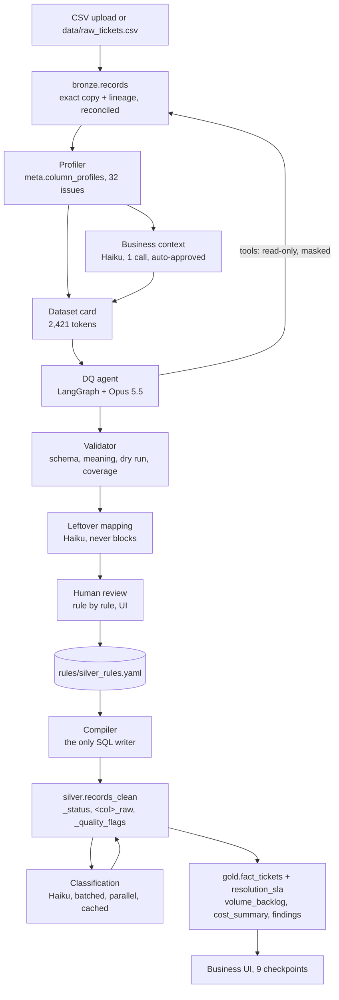

# Data Medallion

A bronze → silver → gold pipeline for messy CSVs on PostgreSQL, where AI agents propose, people
approve, and plain code executes. Built and measured on `data/raw_tickets.csv` (10,280 facilities
tickets × 13 columns). One command rebuilds everything from a fresh clone with no API key, and then
replays the recorded AI review to show that it reproduces.

| | raw_tickets.csv |
| --- | --- |
| Bronze | 10,280 / 10,280 records stored as-is, 0 lost, reconciled |
| Health check (profiler, no LLM) | 32 issues: 5 high, 25 medium, 2 low |
| DQ agent (Opus 5.5) | 11 turns, 20 tool calls, $0.59, 109 s, 0 failed validations, 30/30 issues covered, 3 questions for a person |
| Human review | 18 rules reviewed one by one; 3 changes (category list, priority mapping, self-declared duplicates) |
| Silver | 7,699 clean + 1,736 with a warning = 9,435 usable; 22 rejected; 823 duplicates |
| Classification (Haiku 5.5) | 286 categories recovered from text, 34 unsure; $0.009; rerun 100% cache |
| Gold | fact + 3 marts + 6 data-quality findings; 5/5 reconciliation checks |
| Headline finding | `resolved_at` is unrelated to `created_at` (correlation 0.01): time metrics are not meaningful for this file |
| Replay | fresh clone, no key: same numbers, 0 API calls, recorded AI review reproduces (11 turns, same proposal) |
| Tests | 216, lint clean |
| LLM spend, final review | $0.61 |

## Contents

[Architecture](#architecture) · [How to run](#how-to-run) · [Bronze](#bronze) · [Silver](#silver) ·
[Gold](#gold) · [Findings](#findings-on-raw_ticketscsv) · [Agents (assessment)](#agents-assessment) ·
[Reproducibility](#reproducibility) · [Engineering](#engineering) · [UI](#ui) ·
[Scaling to 100x](#scaling-to-100x) · [Tradeoffs](#tradeoffs) · [Scope and size](#scope-and-size) ·
[Not built](#what-i-chose-not-to-build) · [Open items](#open-items) · [Time spent](#time-spent) ·
[Design](docs/design.md) · [Decisions](docs/decisions.md) · [Metric contracts](docs/metrics.md)

## Overview

Principle: **agents propose, code executes, people approve.** No LLM touches data or writes SQL.

- The profiler measures every column in code (counts, formats, placeholders, date order) and flags
  issues with evidence.
- The DQ agent reads a compact, masked summary of that profile, investigates with read-only tools, and
  submits cleaning rules as strict JSON. A validator checks them in four layers, including a dry run
  on 2,000 real rows and coverage of every high and medium issue.
- A person reviews each rule in the UI. Approved rules (`rules/silver_rules.yaml`) are compiled to SQL
  by one compiler and built into silver with value-level lineage.
- A cheap model recovers categories from free text where rules could not, cached and closed-list.
- Gold is hand-written SQL with written metric contracts and a table of data-quality findings, so a
  number never appears without how much data it covers and what limits it.

## Architecture



DQ agent graph (`python -m pipeline.cli dq-graph`, also in [docs/dq_agent_graph.md](docs/dq_agent_graph.md)):


| Postgres schema | Holds |
| --- | --- |
| `meta` | runs and load funnels, profiles, contexts, cards, LLM calls + cache, tool calls, agent runs, silver/gold builds, classification cache |
| `bronze` | `records` (raw payload + `raw_line` + lineage), `load_errors` |
| `silver` | `records_clean` (+ `_valid` view), `ai_labels`, safe-cast SQL functions |
| `gold` | `fact_tickets`, `dim_*`, `resolution_sla`, `volume_backlog`, `cost_summary`, `data_quality_findings` |

Code: `backend/pipeline/` (bronze, profiling, context, card, llm, privacy, agent_tools, dq_agent,
silver/{rules_schema, compiler, validator, build, classify, mapping_assist}, gold/build, web, demo).
Business model for gold: `gold/model.yaml` + `gold/sql/`. Migrations: `db/sql/`. Techniques and the
reasons behind them: [docs/design.md](docs/design.md).

## How to run

**Fresh clone, one command, no API key** (Docker required):

```bash
make demo
```

This starts Postgres and the backend/UI (`docker compose up`), then runs inside the backend container:
init-db (loads the recorded LLM answers from `fixtures/`) → ingest → profile → business context →
approved rules from the repo → silver → classification → gold → replay of the recorded AI review. It
prints the counts and the UI address: **http://localhost:8000**. Expected output (the JSON summary, shortened):

```
silver            7,699 kept, 1,736 flagged, 22 rejected, 823 duplicate (of 10,280)
classification    320 targets, 314 cache hits, 0 LLM calls, 286 recovered, 34 unsure
gold              5/5 checks, 9,435 tickets
ai_review_replay  replayed: true, 11 turns, 20 tool calls, matches_recorded_proposal: true
```

| | Demo (default) | Live |
| --- | --- | --- |
| Setting | `LLM_MODE=replay` (nothing to set) | `LLM_MODE=live` and `LLM_API_KEY` in `.env` |
| Model answers | only from `meta.llm_cache`, loaded from `fixtures/llm_cache.jsonl`; no key, no network | cache first, then the API; new answers are cached |
| Rules | the approved rules in the repo, bound to the file by its sha256 | the agent proposes; you approve rule by rule in the UI |
| AI review | `dq-run` replays the recorded review to its approval pause | a new review, about $0.60 and 2 minutes for 13 columns |
| A different CSV | bronze, profile and card work; AI steps print a one-line "not in the recorded cache" | everything works |

`LLM_MODE=record` always calls the API and overwrites the cache entry.

How the demo reproduces a reviewed result on a new database: run ids are random, but approval is about
the file. `rules/silver_rules.provenance.json` records the file's sha256, the approved business
context, the review decisions, the sampling seed of the reviewed profile and a fingerprint of the
agent's proposal; when the ingested file matches, the approved rules are bound to the new run (only
`source_run_id` changes).

**Local development** (Python 3.12):

```bash
cp .env.example .env
make venv            # .venv + backend/requirements.txt
make up init-db      # Postgres + migrations + fixtures
make ui              # UI on http://localhost:8000 (stop the compose backend first, same port)
make test            # 216 tests against the local Postgres
make lint            # ruff, rule set in ruff.toml
make fixtures        # re-export fixtures/*.jsonl and the approved-rules provenance
```

CLI (`cd backend && python -m pipeline.cli <command>`): `ingest <csv> [--force]`, `runs`, `profile`,
`context [--context-file F] [--compare]`, `card [--exact]`, `dq-run [--fresh]`, `dq-status`,
`dq-approve`, `dq-reject --reason R`, `validate-rules F`, `build-silver`, `classify-category [--mode live]
[--check N]`, `category-eval-sheet`, `category-eval F`, `build-gold`, `metrics`, `demo`, `export-fixtures`.
Expected failures (no recording, no run yet, database down) print one line and exit 2; anything else
keeps its traceback.

## Bronze

`ingest` loads any CSV into `bronze.records` without knowing its columns.

- **Faithful, schema-on-read:** each record keeps its exact text (`raw_line`) and a `payload` JSONB of
  `{column: raw string}`. Nothing is trimmed, cast or nulled. Empty or repeated header names are
  renamed (`column_<n>`, `<name>_2`); the original header is stored on the run.
- **Malformed rows are kept:** too many or too few fields, blank lines and unclosed quotes load with
  `parse_status = 'malformed'` and an exact `parse_error`; rows the database refuses go to
  `bronze.load_errors`.
- **Lineage:** `run_id`, `source_file`, `source_line`, `batch_no`, `ingested_at`, `row_hash` (sha256 of
  `raw_line`).
- **Idempotent:** a file is identified by its sha256; re-ingesting is skipped; `--force` or a failed
  run replaces the old run. Repeated rows inside a file are kept (deduplication is silver's job).
- **Batched and atomic:** one transaction per run, a savepoint per batch, COPY with a row-by-row
  fallback for a failing batch.
- **Reconciliation:** physical lines → records parsed → loaded ok + malformed + refused; the three must
  add up (in memory and in the DB) or the run fails.

raw_tickets: utf-8-sig, 10,281 lines, 10,280 records, all loaded, 11 COPY batches, under 0.5 s. The
file is structurally clean; all the mess is in the values. Rebuilding the file from `raw_line` gives
the original bytes.

## Silver

### Profiling (no LLM)

Per column: completeness, null-like tokens, cardinality and role, top values, pattern masks, type
shares, date formats with day/month evidence, numbers in text by kind, sentinels, spelling variants
and typo neighbours, PII hints. Per dataset: exact/near duplicates, key repeats with a hint, date order
with format-pair evidence, partial rows. 32 issue codes with documented severity rules, under 2 s for
10,280 rows. All thresholds live in one `PROFILE_CONFIG` whose hash is stored with every profile. A
profile depends only on the file and that config: value samples are seeded with the file's sha256.

### Rules, compiler, validator

- The agent submits `SilverRules` (strict Pydantic, extra fields forbidden): per column the target
  type, cleaning steps from a fixed menu, null tokens, sentinels, a standard-value mapping, date formats
  by registry id, range, required, and a `why`; plus row checks, dedup, issue coverage and questions
  for a human.
- Row checks: `date_order`, `required_if`, `not_both_null`, and three row fixes:
  `swapped_columns` (swap a label column and a text column back when the label column holds a sentence
  and the text column holds a known label), `junk_row` (rows that are mostly empty/placeholders
  or whose id fails the dominant pattern), `declared_duplicate` (mark rows whose notes say "duplicate
  of ticket #N" as duplicates of that ticket).
- `pipeline/silver/compiler.py` is the only code that writes silver SQL; every value enters through
  `psycopg.sql.Literal/Identifier`. The query is a stack of named layers (clean → null tokens →
  mapping → typing → range → row checks). Dates are parsed as strictly as Python (round-trip check);
  every one of the 31 registry formats (+ 9 day-first variants) round-trips Postgres vs Python in a test.
- The validator runs schema → meaning → dry run (2,000 fixed rows, read-only role, 10 s) → coverage
  (every high and medium issue fixed by a rule or ignored with a reason). Warnings go to the reviewer,
  e.g. a typed column with ≥ 2% of non-empty values unreadable.

### Build

`build-silver` (and automatically after **Finish review**) applies the **approved** rules once, into a
staging table, reconciles, and swaps it in with its key, index and `<target>_valid` view in one
transaction. Every build stores its exact rules YAML, hash and SQL digest in `meta.silver_builds`.

- **Nothing is dropped:** one row per bronze row with `_status` = `kept` | `flagged` (kept, warnings in
  `_errors`) | `rejected` | `duplicate`. `silver.records_clean_valid` = kept + flagged.
- **Lineage per value:** `bronze_id`, `_source_line`, `<col>_raw` for every value a rule can change,
  `_quality_flags` (cleaned, null_token, sentinel, mapped, unmapped, unparseable, swapped,
  declared_duplicate, ai_labelled…), `_duplicate_of`, `_build_id`.
- AI category labels are re-applied on every build as `category_ai`, `category_ai_confidence`,
  `category_source` (`rule` | `ai` | `none`); `category` itself is never overwritten.

raw_tickets (approved rules, 12 s): 10,280 → **7,699 kept, 1,736 flagged, 22 rejected, 823 duplicates**.

- Duplicates: 823 tickets whose notes say "Duplicate of ticket #N" (every N exists). They stay in the
  table with `_duplicate_of` and are out of `records_clean_valid`, so gold does not count them.
  `ticket_id` itself never repeats (dedup on the key finds 0).
- 45 rows had category and description swapped back; 30 junk rows flagged; 22 rows rejected for a
  missing ticket id.
- Dates: 14 formats listed, including epoch seconds; 23 `created_at` values stay unreadable (`asap`,
  `00/00/0000`, `not a date`).
- Priority: 19 spellings → 4 levels (`hi`→high, `med`/`normal`→medium, `lo`→low,
  `crit`/`urgent!!!`/`asap`→critical); 1,008 tickets have no priority.

## Gold

`build-gold` (automatic after a silver build in the UI) builds from `silver.records_clean_valid`. The
business model lives outside the pipeline: `gold/model.yaml` (resolved and escalated statuses, optional
role overrides) and `gold/sql/*.sql`. The engine maps roles (id, opened, closed, category, priority,
status, location, money, sla) from the business-context column tags and the approved date-order check,
builds in `gold_staging`, reconciles and swaps in one transaction (`meta.gold_builds`).

### Why these three tables

The business context for this file says operations managers use it to track how fast issues are
resolved against SLA targets, how often requests escalate, and what repairs cost across buildings and
categories. Each mart answers one of those questions at the grain a manager would ask it:

| Table | The manager's question | Grain | Rows |
| --- | --- | --- | --- |
| `gold.resolution_sla` | Are we resolving tickets within the SLA, and where not? | created month × priority × category | 942 |
| `gold.volume_backlog` | How much work comes in, how much closes, how big is the backlog? | month × category × building | 3,541 |
| `gold.cost_summary` | What do repairs cost, by category and building? | category × building | 196 |
| `gold.fact_tickets` (+ `dim_category`, `dim_building`, `dim_priority`) | Everything else: one row per ticket for ad-hoc questions | ticket | 9,435 |
| `gold.data_quality_findings` | Which of these numbers can I trust? | finding | 6 |

A fact table plus three narrow aggregates is the smallest model that covers the stated metrics; a
star schema with more dimensions would add tables no stated question needs. The findings table is
there because, for this file, the honest answer to the first question is "not from this data".

### Metric contracts

Full text in [docs/metrics.md](docs/metrics.md), also as `COMMENT ON COLUMN`.

- Tickets = kept + flagged silver rows. **Flagged rows count everywhere**; they are excluded only from
  time metrics, and only when their dates are unusable. Duplicates and rejected rows never count.
- `usable_for_time_metrics` = resolved (status `resolved`/`closed`) AND both dates known AND
  `resolved_at >= created_at`. Median / avg / p90 resolution hours and SLA met rate use only these rows;
  `coverage_pct` = usable / resolved and `excluded_count` sit next to every time metric.
- `escalation_rate_pct` = tickets whose **current** status is escalated / tickets (no status history).
- Volume: `opened` by created month (a NULL-month row for unknown dates, so the sum equals the fact
  rows); `closed` only with a valid closing date; `open_at_month_end` excludes tickets closed at an
  unknown time.
- Cost: totals and averages over tickets with a known cost; `cost_coverage_pct` beside them.
- Priority and category show only approved standard values; anything else is `(unknown)`.
- Reconciliation (build fails otherwise): fact rows = silver valid rows; opened, SLA tickets and cost
  tickets each sum to fact rows; cost totals match.

## Findings on raw_tickets.csv

| Severity | Finding | Evidence | Handling |
| --- | --- | --- | --- |
| High | **Resolution dates are unrelated to creation dates** | 35.4% of tickets with both dates (1,728 of 4,883) resolve before they open; pairing dates at random gives 35.0%; correlation 0.01 | Flagged, not swapped; excluded from time metrics; time metrics marked **unreliable** in gold and the UI |
| High | Dates in many formats per column, incl. epoch seconds | month-first proven by 1,863 values, day-first by 0 | one timestamp type; 23 non-dates remain |
| Medium | Self-declared duplicates | 823 notes "Duplicate of ticket #N", all pointing at existing tickets; `ticket_id` never repeats | marked duplicate, out of every gold number |
| Medium | Labels split by synonym | category 111 spellings; priority hi / crit / lo / Normal / urgent!!! / ASAP | mappings + AI leftover mapping + classification |
| Medium | No IT category in the obvious list | Network, WiFi, IT Support, Connectivity… | `network` standard value (957 tickets) |
| Medium | Open tickets already have a resolution date | 1,953 of 6,410 | status trusted, date ignored |
| Medium | Cost missing | 36.7% empty, N/A, TBD, error or placeholders (-1, -999) | totals shown with coverage |
| Low | Swapped columns, junk rows | 45 sentences in category with the label in description; 30 junk rows (`DELETE ME`, `test`, ids like `15`) | swapped back; flagged |

Monthly volume is steady at up to about 560 tickets opened; validly dated closures grow from 0 to about
350 a month, so the backlog curve (6,402 open at July 2025) mostly reflects the unreliable resolution
dates.

## Agents (assessment)

Two required agents, (b) data quality (with (a) schema typing folded in) and (c) semantic
classification, plus two small LLM helpers. (d) gold design was not built (see below).

### (b) Data-quality agent: Opus 5.5, LangGraph

- **Does:** reads the dataset card, investigates with 7 read-only, masked tools (profiles, value counts,
  regex checks, a dry run of one rule on 2,000 rows, cross-column checks), and submits rules with
  business reasons, issue coverage and questions it can't settle.
- **Input (excerpt of the card it reads every turn):**
  ```
  - DATEFMT:created_at: ex=[YYYY-MM-DDTHH:MM:SS 0.26,YYYY-MM-DD HH:MM:SS 0.2] format_count=8
  - AMBIG:created_at: ex=[<99/99/9999>] ambiguous=1234 dmy_evidence=0 mdy_evidence=1863
  - SENTINEL:created_at: sh=0.0008 ex=[0000-00-00×8]
  ```
- **Output (one of its rules):**
  ```yaml
  - name: created_at
    type: timestamp
    null_tokens: [tbd]
    sentinels: ['0000-00-00']
    day_month_order: mdy
    why: created_at comes in 8 formats. 1,863 values only make sense as month-first and none as
      day-first, so the 1,234 ambiguous slash dates are read as mdy. Tested: only 0.05% of rows stay
      unparseable. 'tbd' and '0000-00-00' become NULL so they don't skew time-to-resolution.
  ```
- **Cost and time:** 11 turns, 20 tool calls (12 value counts, 3 column profiles, 3 rule tests, 1 sample,
  1 issue list), 2,421-token card cached across turns, **$0.59, 109 s**, 0 failed validations. It hit
  the 20-call budget on turn 10: two more calls were answered "not run" and it was told to submit.
- **Worth it:** it turned 32 flagged issues into validated rules for 11 columns with correct judgement
  calls (sentinels vs real values, mdy from evidence, NULL resolution dates kept for open tickets), a
  swapped-columns fix, a junk-row check, and 3 sharp questions for a person, e.g. whether the 35% of
  tickets resolved before creation are swapped at the source. In this run it also found the epoch
  date format and the missing IT category by itself. Saved me: TODO(naveen) (estimate vs writing the
  rules by hand).
- **Not enough on its own, and not the same twice:**
  - This run proposed **no mapping for priority**, so `hi`, `med`, `lo`, `crit`, `normal`,
    `urgent!!!` and `asap` would have reached gold as separate priorities. The validator could not
    object: without a mapping nothing is "unmapped".
  - It proposed dedup on `ticket_id` (which finds 0) and **missed the 823 tickets that say they are
    duplicates** in their notes.
  - An earlier run on the same file got priority right but missed the epoch dates and the IT
    category. The misses move between runs; the review is what makes the result stable.
  - Both gaps were closed in the human review (priority mapping, `declared_duplicate` rule). The
    structural answers are the rule-by-rule review, the leftover-mapping step, the ≥ 2% unreadable
    warning, and a recording that replays, so a reviewed result does not depend on running it again.

### (c) Semantic classification: Haiku 5.5, batch job

- **Does:** for rows whose category the rules could not standardise, one label from the closed list
  (approved categories + `other`, JSON schema) with a confidence, from the category field plus the
  free-text fields with emails, phones and person names scrubbed. Below 0.6: no label, flagged.
- **Input → output (real):** `category: Other | description: Paint peeling in Annex West lobby. Looks
  bad for visitors.` → `general_maintenance` (0.70). Result on this file: 265 `general_maintenance`, 20
  `other`, 1 `hvac`; 34 left empty as unsure.
- **Cost and time:** 320 rows → 314 distinct texts → 7 calls of up to 50, **$0.009, 26 s** with 4
  batches in parallel (about 8 s per call, so roughly 57 s one after another); rerun 100% cache, $0,
  0.5 s. Agreement with rule labels on 200 rule-mapped rows: 99.5% (one disagreement).
- **Worth it:** the leftovers are exactly the values a mapping cannot settle (`Other`, `Misc`,
  `General` with the meaning in the description); 286 tickets got a category for under a cent. Much
  smaller than before the agent's mapping improved (an earlier review left 977 rows for this step):
  the better the rules, the less the classifier has to do. Accuracy against human labels:
  TODO(naveen) (fill `human_label` in `data/eval/category_eval_74511b78.csv`, then
  `python -m pipeline.cli category-eval data/eval/category_eval_74511b78.csv`).

### Helpers

- **Business context draft (Haiku, 1 call, $0.0004):** what the data is for, which columns are
  critical, and a tag per column (person columns are masked everywhere afterwards; gold finds its roles
  through these tags). The first attempt hit a provider 503; the review retries it, and the UI has a
  "Try again now" button. Worth it: cheap, and the agent's reasons are about the business ("SLA
  compliance", "cost by building") because of it.
- **Leftover mapping (Haiku, $0.001):** decides values the agent's mappings missed (merge / new / empty
  / keep + reason) so the reviewer only checks: 38 category values decided after the agent, 4 more on
  a second request from the review page. Worth it: it turned a 38-value dropdown chore into a check.

### Where an LLM was not used, on purpose

Counting, formats, sentinels, duplicates and the date-order statistics (code is exact and
reproducible); SQL (the compiler); gold metrics (contracts must be exact). The date-order verdict came
from a shuffle test, not from a model.

LLM spend for the final review of raw_tickets: DQ agent $0.594, classification $0.0135 (incl. the
200-row agreement check), leftover mapping $0.0012, context $0.0004 → **$0.61**. Earlier iterations
on this file cost about $1.67 more (two agent runs; that database was reset, the figure is from its
call log). Every call is in `meta.llm_calls` with tokens, cost and latency.

## Reproducibility

Recorded answers are keyed by the exact request, so replay only works if everything a model reads is
a pure function of the file. Making the agent run replay on another database took four fixes, each
found by diffing a fresh database against the recorded one:

| What differed | Why | Fix |
| --- | --- | --- |
| Card header | it named the run id and the upload's file name | the card names the file by sha256 |
| Value samples in tool results | sampling was seeded with the run id | seeded with the file sha256; the seed is stored with the profile |
| Leftover-mapping prompt | built from a dict whose order `jsonb` storage changes | standard values are sorted |
| `test_rule` top-5 lists | rows read without `ORDER BY`, so ties followed the query plan | file order |

Proof before changing any key: with the old header put back, the recorded review replayed all 11
turns on a fresh database against the original recorded requests. The answers are then stored under
the new-header keys (that line is the only difference). The recorded review's samples were drawn with
its run id as the seed, so the provenance file carries that seed and the demo profiles with it: the
model's recorded answers are replayed against exactly the values it saw.

`tests/test_llm_contract.py` pins every prompt and schema sent to a model by hash, so an accidental
prompt change (even a docstring on a Pydantic model behind a tool schema) fails a test instead of
silently breaking replay.

## Engineering

- **Lint:** `ruff.toml` selects bugbear, bandit, complexity, exception, logging, timezone, typing and
  docstring rules; the code is formatted with `ruff format` and passes all of them. Each deliberate
  exception has its reason in the config.
- **Tests:** 216 against a real Postgres: parsing edge cases, reconciliation, the compiler against a
  golden SQL file, date formats Postgres vs Python, the validator layers, the agent graph with a
  scripted model (budget, retries, approval, replay), the UI API, classification (parallel batches,
  cache), gold contracts, CLI errors, the LLM contract.
- **Errors:** expected failures share one base class (`PipelineError`) and reach the user as one
  actionable line; builds record their failure in `meta.*_builds` and log the traceback.
- **Logging:** structured `key=value` lines with `stage` and `run_id` on every line; counts and
  durations per stage; every LLM call with tokens, cost, latency and cache hit.
- **Safety:** agent tools and validator dry runs use a NOLOGIN read-only role inside a read-only
  transaction with a statement timeout; SQL identifiers and values go through `psycopg.sql`.
- **Concurrency:** classification batches run on a bounded thread pool (`CLASSIFY_CONCURRENCY`).
  The rest is deliberately synchronous: database-bound work on sync `psycopg`, a sequential agent
  loop, and web requests already served from a thread pool.

## UI

http://localhost:8000 (`make demo` or `make ui`). Upload a CSV and follow it through 9 checkpoints in
plain language: file → bronze funnel → health check → business context → AI briefing (the exact card)
→ AI review (every step, what it asked and got back, cost) → **your approval** → silver → gold.

- Approval is **rule by rule**: each card shows what the rule does, why, the issues it fixes, its effect
  on all rows, every setting and its YAML; Approve / Reject (with reason) / Undo; values outside a
  standard list get a dropdown (merge / new / empty / leave) and an AI suggestion; a YAML editor that
  validates before saving; Finish review builds silver and gold; a finished review can be reopened.
- Silver shows before → after for every value; any row opens **the journey of one record** (file line
  → bronze payload → silver value by value, with the fix that explains each change).
- Gold leads with the data-quality findings; metrics a finding invalidates are muted and badged
  **unreliable**; coverage and excluded counts sit next to each number; the volume chart has separate
  axes for monthly flows and the cumulative backlog.

## Scaling to 100x

- **Bronze:** one transaction per run is fine for ~10k rows. For 1M+ rows, commit per batch with a
  resume checkpoint (`last_committed_line`) so a crashed load resumes. Memory is already flat
  (records are streamed).
- **Profiling:** move counts to SQL aggregates (`GROUP BY payload->>col`) and run per-value regex work
  (masks, types, dates) on a fixed, seeded ~50k-row sample; replace exact distinct counts and top values
  with sketches (HyperLogLog, count-min, t-digest). Profile size grows with columns, not rows.
- **DQ agent:** cost is per dataset (≈ columns × tool calls), not per row: the card has a fixed token
  budget with a coverage guarantee, and the rules are reused for every later file with the same
  schema. At 100× rows nothing changes except the dry-run sample.
- **Silver:** the compiled query is set-based; at 10M rows build per partition (e.g. by `run_id` or
  month) with `INSERT … SELECT` into a partitioned table instead of one `CREATE TABLE AS`, and keep the
  staging + swap per partition. The date parser is `PARALLEL UNSAFE` (exception blocks); a regex
  pre-filter per format keeps the exception path rare.
- **Classification:** cost scales with **distinct** texts, not rows (dedupe + per-text cache): 320 rows
  → 314 texts here; templated tickets collapse much further at scale. Batches of 50 on the cheap model
  already run in parallel; the cache makes reruns free. At 10M rows, use the provider's batch API for
  the first backfill and keep the per-text cache for the daily tail.
- **Gold:** the marts are aggregates over the fact table; at scale, incremental refresh by month
  partition and materialized views.
- **UI:** previews already read the stored silver table; job progress would move from memory to a table
  and a worker queue.

### Daily incremental loads (design, not built)

**Current limit:** silver is rebuilt in full from one bronze run, so a second file replaces the
first. For a daily feed the design is:

- **Bronze:** one run per file, as today. A file is identified by its sha256, so a re-sent file is
  skipped; rows are identified by `(run_id, row_hash)`, which is the idempotency key downstream.
- **Silver:** `MERGE` into a persistent table on `ticket_id`, keeping the latest version of a ticket:
  order by source run (file date, then ingestion time) and then by the ticket's updated timestamp. The
  same compiled rules produce the staging rows for the new run; only the final statement changes from
  `CREATE TABLE AS` to `MERGE`. Each row keeps the `run_id` and `row_hash` it came from.
- **Late-arriving records:** every load re-merges a replay window (the last N days of runs, e.g. 7),
  so a correction that arrives late still wins or loses on the same ordering. Re-merging is
  idempotent because the key and the ordering are deterministic.
- **Duplicates:** self-declared duplicates are resolved against the whole table, not the file, so
  "duplicate of ticket #N" works when N arrived on another day; cross-file repeats of one ticket are
  versions of it, handled by the merge.
- **Gold:** refresh only the months (and category × building cells) touched by the merged rows; the
  reconciliation checks run per refreshed partition.
- **Backfill:** replay the stored bronze runs through the current approved rules version, in order.
  Bronze is immutable and builds record their rules hash, so a backfill is reproducible and can be
  compared with what it replaces.
- **Rules:** approved per schema, not per file. A new file is profiled; the review is only reopened
  when the profile drifts (a new issue code, a new date format, new leftover values above a share).
- **No double counting:** a ticket contributes to a month through its current silver row only, and
  gold is rebuilt from silver for the affected partitions rather than incremented.

## Tradeoffs

- **Rules, not SQL, from the agent:** safer and reviewable, but limited to what the rule menu can
  express; new cleaning needs (the three row fixes) required compiler work.
- **One silver table per target:** simple and fully reconciled, but building another file with the
  same target replaces it (see daily incremental loads).
- **Approved rules bound to the file (sha256), not the run:** reproducible fresh clones; a changed file
  needs a new review.
- **Closed category list:** the AI can't invent categories, so a missing category shows up as `other`
  until a person adds it.
- **Time metrics built although unreliable:** the contracts stay the same for every file; for this
  file they are marked unreliable rather than dropped.
- **Replay determinism:** recorded answers make reviews free and reproducible, but any change to what
  the agent sees (prompt, tools, card, rule schema) invalidates the recording; the contract test makes
  that an explicit decision.
- **Custom profiler instead of ydata-profiling / Great Expectations:** JSON shaped for the agent and
  targeted checks (day/month evidence, sentinels, key repeats), at the cost of writing and testing it.

## Scope and size

| Part | Lines of Python | What |
| --- | --- | --- |
| Core pipeline | about 6,100 | bronze, profiler, dataset card, context, LLM client, rule schema, compiler, validator, silver and gold builds, CLI, demo |
| Agents | about 1,700 | DQ agent graph, its tools, classification, leftover mapping |
| UI | about 2,400 (+ 1,500 HTML/JS/CSS) | FastAPI routes, views, rule-by-rule review |
| Tests | about 3,100 | 216 tests |

The brief asks for a pipeline and two agents: that is the first two rows, and within them the
profiler is the largest piece (it is what lets a 2,400-token card stand in for 2 MB of data). The UI,
the record-level lineage view, the replay machinery and the leftover-mapping helper go beyond the
brief; they exist because a human approval gate needs something a person can actually review. This is
more code than a 4–5 hour exercise; the time is in [Time spent](#time-spent).

## What I chose not to build

- **Agent (d), gold design:** at 13 columns and three business questions, hand-written SQL with
  contracts is clearer, testable and cheaper than an agent; the business context already names the
  metrics.
- **Agent (a) as a separate agent:** schema typing is part of the DQ agent's rules (`type`,
  `parse_formats`); a separate agent would duplicate the profile reading. Schema drift detection is
  not built (see the rules bullet under daily incremental loads for where it would go).
- **Swap-if-reversed dates:** the evidence says the dates are unrelated, not swapped.
- **Sentiment / product-area enrichment:** no business question in the context needed it.
- **Airflow, Spark, dbt, a React app, auth:** one CSV of 10k rows; the 100x section says what changes.

## Open items

- **Three questions the agent left for a person** (in `rules/silver_rules.yaml`, `needs_human`): are
  `created_at` and `resolved_at` swapped at the source; does a cost of 0 mean free or unknown; is
  month-first correct for every source system.
- **Classifier accuracy against human labels:** 40 tickets to label (see the classification section).
  The sheet identifies rows by `bronze_id`, so it must be scored on the database it was made on.
- **Dependencies are not pinned** (`backend/requirements.txt` uses minimum versions); a lock file is
  the next step for reproducible images.
- **`source_file`** stores the path the file was ingested from; file name + sha256 would be cleaner.
- **The recorded review predates the content-based sampling seed**, so the provenance carries its seed.
  A new recording would use the file's sha256 and need no seed.
- **Time spent and "saved me" estimates** below and in the agent section.

## Time spent

TODO(naveen): fill in from `docs/time_log.md` (per step, honest totals; the brief's budget was 4–5 hours).

| Step | Time |
| --- | --- |
| Skeleton + bronze | TODO(naveen) |
| Profiling (v1.0 → v1.3) | TODO(naveen) |
| LLM client, context, card | TODO(naveen) |
| Rules engine + DQ agent | TODO(naveen) |
| UI | TODO(naveen) |
| Silver build, date investigation | TODO(naveen) |
| Classification + gold | TODO(naveen) |
| Submission hardening (lint, refactor, replay) | TODO(naveen) |

## Decisions

The design in one place: [docs/design.md](docs/design.md). Every decision with its reason and the
alternatives rejected: [docs/decisions.md](docs/decisions.md).
